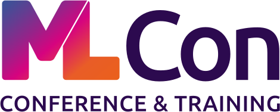

<header>
  
Testimonials

  <h1>In their words.</h1>
  
Feedback from people who have joined my AI courses, conference talks, and hands-on workshops, or worked with me on their AI systems.

  
Selected excerpts from participant surveys, LinkedIn messages, and emails. Names and identifying details are omitted for privacy. Excerpts are lightly edited for spelling and readability, with the original meaning preserved.

</header>

<aside class="testimonial-brands" aria-label="Course and conference sources">
  
Feedback from courses and conferences at

  <ul class="testimonial-brand-list">
    <li></li>
    <li></li>
    <li><a href="https://www.widsworldwide.org/" target="_blank" rel="noopener noreferrer">
      
      WiDS
    </a></li>
    <li><a href="https://www.renderatl.com/" target="_blank" rel="noopener noreferrer">
      
      RenderATL
    </a></li>
  </ul>
</aside>

<nav class="testimonial-jump" aria-label="Testimonial sections">
  <a href="#courses">O'Reilly courses</a>
  <a href="#conferences">Conference workshops</a>
  <a href="#messages">LinkedIn messages</a>
  <a href="#organisers-clients">Organisers &amp; clients</a>
</nav>

<figure class="testimonial-card testimonial-featured">
  <blockquote>
“One of the best presentations and workshops of the entire week, with a very good example repo and very good knowledge of the topic and of the tools from the presenter, thank you, Apurva!”
</blockquote>
  <figcaption>
    Workshop participant · MLCon Munich 2026
    Tooling &amp; Patterns for Reliable AI-Powered Applications
    Post-event survey
  </figcaption>
</figure>

<section class="testimonial-section" aria-labelledby="ratings-title">
  <h2 id="ratings-title">Selected session ratings</h2>
  

    

      
4.75 / 5

      
<strong>Overall course rating</strong> Building with Jev and System One Models

      <small>O'Reilly · October 2026 8 survey responses</small>
    

    

      
4.71 / 5

      
<strong>Workshop quality</strong> Tooling &amp; Patterns for Reliable AI-Powered Applications

      <small>MLCon Munich · 2026 14 participant ratings</small>
    

    

      
5.0 / 5

      
<strong>Workshop quality</strong> Tooling &amp; Patterns for Reliable AI-Powered Applications

      <small>MLCon London · 2026 6 participant ratings</small>
    

  

  
Each score reflects the session shown, based on participant surveys collected by the course or conference organiser.

</section>

<section id="courses" class="testimonial-section" aria-labelledby="courses-title">
  <h2 id="courses-title">From O'Reilly courses</h2>
  

    <figure class="testimonial-card">
      <blockquote>
“It made concrete the notion I had of using AI as a type of personal assistant to delegate tasks. I thought it might be possible, and in this event I was pointed in the right direction of how to make this a reality.”
</blockquote>
      <figcaption>
        Course participant · O'Reilly
        Creating a Personalized Assistant with Claude Code · September 2026
        Post-course survey
      </figcaption>
    </figure>
    <figure class="testimonial-card">
      <blockquote>
“The instructor (Apurva) is knowledgeable, presented the information clearly, and did a great job of handling both the time constraints and the student questions.”
</blockquote>
      <figcaption>
        Course participant · O'Reilly
        Building with Jev and System One Models · October 2026
        Post-course survey · excerpt
      </figcaption>
    </figure>
    <figure class="testimonial-card">
      <blockquote>
“It was a good introduction and demonstration to Jev and I have a much better knowledge about what it is and what kind of problems that it can help me with.”
</blockquote>
      <figcaption>
        Course participant · O'Reilly
        Building with Jev and System One Models · October 2026
        Post-course survey
      </figcaption>
    </figure>
  

</section>

<section id="conferences" class="testimonial-section" aria-labelledby="conferences-title">
  <h2 id="conferences-title">From conference workshops</h2>
  

    <figure class="testimonial-card">
      <blockquote>
“Apurva was amazing, incredibly knowledgeable, and helped put into perspective not just the power, but limitations of these systems, and how best to manage them.”
</blockquote>
      <figcaption>
        Workshop participant · MLCon London 2026
        Tooling &amp; Patterns for Reliable AI-Powered Applications
        Post-event survey
      </figcaption>
    </figure>
    <figure class="testimonial-card">
      <blockquote>
“Really good session, very knowledgeable speaker, good motivation, content and spirit.”
</blockquote>
      <figcaption>
        Workshop participant · MLCon Munich 2026
        Tooling &amp; Patterns for Reliable AI-Powered Applications
        Post-event survey · excerpt
      </figcaption>
    </figure>
  

</section>

<section id="messages" class="testimonial-section" aria-labelledby="messages-title">
  <h2 id="messages-title">Messages after the session</h2>
  

    <figure class="testimonial-card">
      <blockquote>
“I loved your presentation and your tutorial. I feel like you touched the right topics for the current scenario of AI. Autogen seems super cool. I was hooked throughout your presentation.”
</blockquote>
      <figcaption>
        Conference participant · WiDS 2024
        LinkedIn message · excerpt
      </figcaption>
    </figure>
    <figure class="testimonial-card">
      <blockquote>
“As a non-tech person, it was interesting to learn about APIs and the different tools you introduced.”
</blockquote>
      <figcaption>
        Conference attendee · WiDS 2024
        LinkedIn message · excerpt
      </figcaption>
    </figure>
    <figure class="testimonial-card">
      <blockquote>
“I attended your session about Agentic RAG today at Render ATL and found it incredibly insightful. I'd love to connect and continue learning from your work. Thanks for sharing your knowledge!”
</blockquote>
      <figcaption>
        Conference attendee · RenderATL 2025
        LinkedIn message · excerpt
      </figcaption>
    </figure>
    <figure class="testimonial-card">
      <blockquote>
“It was a valuable learning experience, and I genuinely appreciate the way you explained things — it was super helpful.”
</blockquote>
      <figcaption>
        Conference participant · MLCon 2025
        LinkedIn message · excerpt
      </figcaption>
    </figure>
    <figure class="testimonial-card">
      <blockquote>
“The information shared in the presentation was very intuitive and helpful. I will be using the ChatGPT for the first time now.”
</blockquote>
      <figcaption>
        Workshop participant · Vancouver 2024
        Applications with ChatGPT
        LinkedIn message · excerpt
      </figcaption>
    </figure>
    <figure class="testimonial-card">
      <blockquote>
“Practical actionable advice. Nicely done.”
</blockquote>
      <figcaption>
        LLM session viewer · 2023
        LinkedIn message · excerpt
      </figcaption>
    </figure>
  

</section>

<section id="organisers-clients" class="testimonial-section" aria-labelledby="organisers-clients-title">
  <h2 id="organisers-clients-title">From organisers and clients</h2>
  

    <figure class="testimonial-card">
      <blockquote>
“The depth, clarity, and practical framing came through clearly in the feedback we received.”
</blockquote>
      <figcaption>
        Conference organiser · GIDS 2026
        Email · excerpt
      </figcaption>
    </figure>
    <figure class="testimonial-card">
      <blockquote>
“We have a lot of gratitude for you to step in on such short notice and providing such clear, actionable guidance.”
</blockquote>
      <figcaption>
        AI consulting client · 2025
        Email · excerpt
      </figcaption>
    </figure>
  

</section>

<footer class="testimonial-footer">
  
Explore my <a href="../speaking/">talks and speaking experience</a> or <a href="../ai-workshops/">AI workshops for teams</a>.

</footer>

